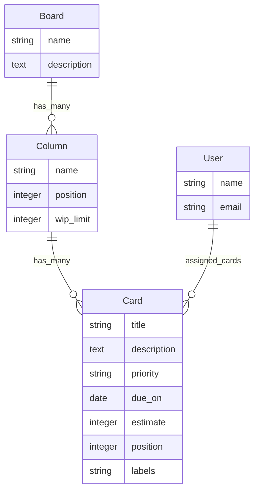

# Kanban Board

> 🚧 A personal Ruby on Rails Kanban board POC built to validate the stack, data model, drag-and-drop workflow, and assignment flow before expanding into a fuller project.

## What This Is

Kanban Board is a Rails-first proof of concept for managing work across columns such as Backlog, Ready, Doing, and Done. It currently focuses on the core product loop:

- View a board with ordered columns and ordered cards.
- Create cards inside a column.
- Drag cards between columns and persist their new position.
- Assign cards to users inline.
- Track common Kanban card fields like priority, estimate, due date, labels, and description.

## Stack

| Layer | Choice | Why |
| --- | --- | --- |
| Framework | Ruby on Rails 8.1 | Productive full-stack defaults and conventional MVC structure. |
| UI updates | Hotwire: Turbo + Stimulus | Keeps the POC server-rendered while still supporting interactive drag/drop and inline updates. |
| Database | SQLite | Simple local development with a clean migration path to PostgreSQL later. |
| Ordering | `acts_as_list` | Battle-tested list positioning for columns scoped to boards and cards scoped to columns. |
| JavaScript | Importmap | No Node build step needed for the current UI. |

## Current Features

- ✅ Demo board seeded with starter columns and cards.
- ✅ Persistent card movement across columns.
- ✅ Scoped ordering for columns and cards.
- ✅ Inline assignee changes with Turbo.
- ✅ Card metadata: priority, labels, estimate, due date, and description.
- ✅ Basic integration coverage for board rendering and card movement.

## Requirements

- Ruby 3.3.x
- Bundler
- SQLite support through the `sqlite3` gem
- GitHub CLI only if you want to manage the remote from the terminal

On this machine, Ruby was installed through RubyInstaller at:

```powershell
C:\Ruby33-x64\bin
```

If `ruby` is not available in a fresh PowerShell session yet, use the explicit executable path:

```powershell
C:\Ruby33-x64\bin\ruby.exe -v
```

## Setup

Install gems:

```powershell
bundle install
```

If `bundle` is not on PATH yet:

```powershell
C:\Ruby33-x64\bin\bundle.bat install
```

Create and migrate the database:

```powershell
bin\rails db:migrate
```

Load demo data:

```powershell
bin\rails db:seed
```

PowerShell note: use `;` to run multiple commands in sequence:

```powershell
bin\rails db:migrate; bin\rails db:seed
```

## Run The App

Start the Rails server:

```powershell
bin\rails server
```

Then open:

```text
http://127.0.0.1:3000/
```

To run on a specific port:

```powershell
bin\rails server -p 3000 -b 127.0.0.1
```

## Run Tests

```powershell
bin\rails test
```

Expected current result:

```text
2 runs, 8 assertions, 0 failures, 0 errors, 0 skips
```

## Data Model



## Useful Commands

```powershell
bin\rails routes
bin\rails console
bin\rails db:reset
bin\rails test
```

## Next Good Iterations

- Add real authentication.
- Add board CRUD and multiple boards per user.
- Add card detail/edit modal.
- Add Turbo Stream updates for drag/drop instead of optimistic-only DOM movement.
- Add WIP limit warnings.
- Move from SQLite to PostgreSQL when deployment or concurrency needs justify it.

## Status

This is intentionally small and pragmatic: a working Rails/Hotwire Kanban slice with the important persistence and interaction questions answered. ✨
